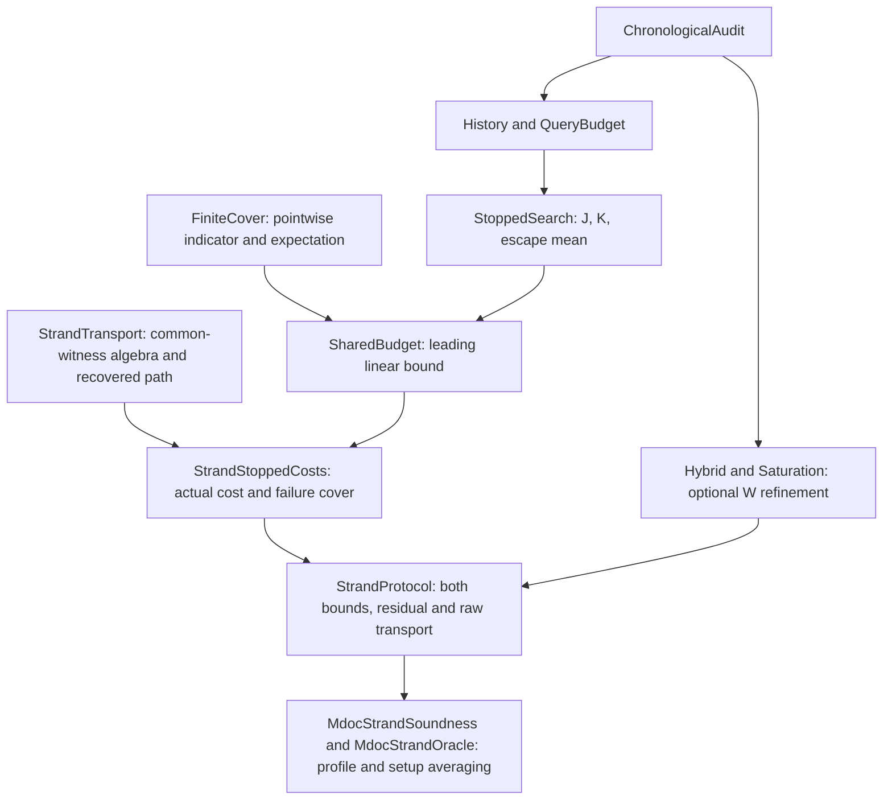

# Shared-budget soundness for the numbered-strand runtime, with an ad hoc Polygero step

This is the pencil-and-paper assembly written before the Lean integration. It concerns the actual
mathematical runtime verifier and extractor modeled by
`LfzkV2.Current.MdocStrandOracle`, rather than a stand-alone sumcheck game.
The existing implementation-correspondence and ideal-sampling boundary is
unchanged. The strengthened runtime endpoint is now checked in the upstream Lean development.

Generic chronological survival, stopped-search and saturation results remain
in `Survival`. Runtime-specific bridges and production numerical bounds live
in `LfzkV2.Current.Soundness`; this separation preserves standalone component
results while keeping application parameters out of the generic library.

## Core argument and theorem dependencies

Fix the witness pair selected from the original commitment cut. The common
algebraic cover concerns this pair throughout both fields, packing and the
adapter. Run the existing chronological audit on the prover's original search,
stopping at the first transparent escape. Let $E$ be that escape, $X$ the raw
recovery exception, $J$ the number of transparent queries reached, $K$ the
number of opaque queries reached, and $C$ the retained opaque cost. The escape
query is included in $J$, and pointwise $J+K\le Q$. Write $p$ for the
local transparent hazard and $b\le p$ for the opaque charge allowance.

The central deterministic statement is

$$
\mathbf 1_F\le\mathbf 1_X+\mathbf 1_E+C.
$$

The chronological hazard and the unconditional charging theorem give

$$
\Pr[E]\le p\,\mathbb E[J],\qquad
\mathbb E[C]\le b\,\mathbb E[K],\qquad b\le p.
$$

Therefore

$$
\Pr[F]\le\Pr[X]+p\,\mathbb E[J]+b\,\mathbb E[K]
\le\Pr[X]+pQ.
$$

`SharedBudget.linear_le` proves this with no $pQ\le1$ restriction.
It never conditions the backend charge on eventual transparent safety.
`Saturation` separately improves the same accounting to $W(Q)$ when
$pQ\le1$. Both runtime methods use the same `StrandProtocol.stoppedCost`,
`stopped_failure_cover` and `conditioned_cost_mean_le`; neither method supplies
an additional runtime certificate or changes the extractor.

The module graph reflects this order:

`StoppedSearch` and `SharedBudget` have no import path to `Hybrid`,
`Saturation`, V1 or V2. Application raw-to-named realization and recovery facts
are proved in their existing modules; they are used to derive the actual
runtime cover before either probability estimate. Residuals are averaged
before the raw hash exception is bounded; the complementary setup slice is
averaged last.

The concrete auxiliary charge fits the opaque allowance for $Q<2^{127}$.
For larger budgets, $pQ\ge1$ and the leading bound follows from probability
being at most one. Thus the complete endpoint holds for every $Q\ge0$:

$$
P_{\mathrm{fail}}(Q)\le
\frac{2Q}{2^{128}-1}+\frac{\binom Q2+r+15}{2^{256}}.
$$

`MdocStrandOracle.averaged_linear_ratio_le` is the complete one-SHA endpoint
for this bound. The exact saturated theorem below remains the sharper
conclusion in its intended range.

## Statement

Put

$$
q=2^{128},\quad M=q^2,\quad p=\frac{2}{q-1},\quad
b=\frac cq,\quad \theta=\frac bp=\frac{c(q-1)}{2q}.
$$

Let the numbered-strand runtime use the current rate-1/7 profile
`(k,s,n,t)=(349,12,2443,84)`. Let `r<2^64` be its number of rounds, one per `begin_squeeze()` call.
For any finite classical adaptive adversary making at most `Q` distinct
original SHA queries, with `Q<q/2`, the strengthened bound is

$$
\Pr[\mathrm{accept}\land\mathrm{paired\ extraction\ fails}]
\le W(Q)+\Delta(Q,r)<0.97,
\tag{1}
$$

where

$$
W(Q)=\frac{cQ}{q}+\left(1-\frac{c(q-1)}{2q}\right)\bigl(1-(1-p)^Q\bigr),\qquad
\Delta(Q,r)=\frac{\binom Q2+r+15}{M}.
\tag{2}
$$

The exact coefficient for this profile is

$$
c=\frac{C}{q^{12}}+\frac{qC}{\ell^{13}}
  +\left(1+\frac q\ell\right)\left(1+(L-1)T\right),
$$

where `C=binomial(2443,374)`, `T=binomial(866,84)/binomial(2443,84)`,
`L=1272737905242889781956743699885451`, and
`ell=2^256-2^224+2^192+2^96-1`. Its value is approximately
`1.0000012312149082441647508747`; Lean checks the strict enclosure
`1.00000123121490824416 < c < 1.00000123121490824417`.
The exact rational is `LfzkV2.Current.Soundness.Rate7.polygeroConstant`; no decimal is
substituted into the soundness formula. Internally the normalized share
`theta` is named `opaqueFraction`. The symbol lambda is reserved for the
security parameter.

A convenient approximation for the mdoc circuit, valid for every $Q\ge0$, is

$$
P_{\mathrm{fail}}(Q)\le Q\,2^{-127}+Q^2\,2^{-257}+2^{-246}.
$$

The largest supported mdoc circuit (four attributes) has 500 rounds:
`275 + 125 + 3*(20 + 11) + 7 = 500`. Thus `r+15 = 515 < 2^10`.
The proof rounds the constant correction up to $2^{-246}$.
The supported one-/two-/three-/four-attribute compiler shapes have respectively
488/492/497/500 rounds. `MdocRoundShape.rounds_eq` derives the total from each
per-layer schedule; `scripts/check_mdoc_round_shapes.py` checks those schedules
against the current Rust compiler. The approximation takes a supported-shape
witness and derives the round bound internally.
`MdocStrandOracle.averaged_mdoc_approximation` proves this all-budget consequence.

For $Q\ge2^{127}$ the approximation follows from probability being at most 1.
For smaller budgets, use the second-order survival estimate

$$
1-(1-p)^Q\le pQ-\frac{p^2Q(Q-1)}2(1-p)^Q.
$$

Together with $(1-p)^Q\ge1/3$, the exact profile bound and elementary
quadratic arithmetic, this gives

$$
W(Q)+\Delta(Q,r)\le
\frac{2Q}{q}+\frac{Q^2}{2q^2}+\frac{r+18}{q^2}.
$$

The three extra units cover the nonzero-field denominator correction.
For the mdoc schedule, $r+18\le518<2^{10}$, giving the displayed approximation.
The exact saturated bound remains **strictly less than 0.97** for $Q<2^{127}$.

The model premises are those of the existing endpoint: one classical ideal
SHA oracle, the approved joint role-block sampling law, canonical field/byte
representations, trusted application circuits, and the existing public
capacity and address bounds. No new execution, causal-readback, cut-equality,
or failure-coverage certificate is supplied by the caller. These facts must
be derived as in the proof below.

## 1. Use the existing experiment and preserve its observation

Use the current raw-to-named coupling and sampler disintegration. A fresh
node draw contains its digest and a privately reserved complete PRF row;
an early PRF query reserves its row instead. Cache reuse handles repetitions
and equal stream keys. Thus arbitrary challenge-reveal order remains legal.

After tagging logical and auxiliary addresses and fixing independent sampler
residual coordinates `z`, write `T_z` for the existing `analysisTree`. It is
a fresh finite-oracle query tree with answers in `D x A`: the digest and the
common ideal joint role alphabet. Freshness follows from `searchState_fresh`,
injective tagging and pointwise answer reindexing. The grouping theorem bounds
its distinct queried coordinates by the adversary's original budget `Q`.

The syntactic fuel can exceed `Q` because memoized calls leave weakenings.
For a fresh tree every branch can be realized by some total oracle: extend
the distinct queried coordinates with the chosen branch answers. Consequently
an all-oracle bound on distinct queried names bounds every branch depth by
`Q`. Rebudget the tree to fuel `Q`, preserving output and complete query trace.
`Survival.QueryBudget` already proves this step.

The existing observation laws retain the submitted bytes, original raw log,
verifier result, and commitment cut. We change neither the verification event
nor the extractor. Independent adversary private choices can be fixed and
averaged at the end.

**Conditioning discipline.** The algebraic/charging argument below is proved
for every fixed residual `z`. The raw missing-node and seal error need only
be bounded AFTER averaging `z`. Fixing a residual can fix raw PRF bits, so a
fresh-seal guessing bound is not asserted separately for each residual.

## 2. Keep the original cut inside the local charges

Instantiate the existing `StrandCharges.localProof` with the ORIGINAL tree
`T_z`. Denote its single-answer charge by `s_x(H,a)` and its linked backend
pair charges by `h_{u,v}(H,a,c)`. Their commitment tuple is exactly the one
extracted from the original first-context cut.

The existing checked facts say:

1. Charges are nonnegative.
2. A single charge is invariant under changing its own implicit coordinate;
   the current candidate answer is supplied explicitly.
3. A pair charge is invariant off its two explicit coordinates.
4. Their one-answer and two-answer means satisfy the current local budgets.
5. After accepted-path recovery/authentication, extraction failure encounters
   a single charge at least one or a linked pair charge at least one.

Most importantly, these weights are now FIXED FUNCTIONS. The generic
`Composition.LocalCharges.charge_mean` theorem can apply them to any query
tree, including a stopped one. It does not require the tree to be the tree
originally used to define the weights' cut. The off-coordinate and local-mean
proofs continue to refer to the original cut. We therefore do not invent a
new commitment tuple after stopping.

## 3. Define the chronological monitor by an explicit partial cache

Call the following query roles opaque:

- the logical joint-backend batching node;
- auxiliary names used by speculative-strand and receiving-Merkle charging.

All other names are transparent. In particular, the backend opening node is
transparent; its existing low-response/outside-list test is a single-answer
test. This does not replace the high-response Polygero analysis by an RBR
argument.

Maintain a table `C` containing all answers obtained so far in `T_z`, with
one fixed fallback at other names. At a transparent query `x`, before revealing
its answer `a`, the monitor fixes the test

$$
\mathrm{escape}(C,x,a)\quad\Longleftrightarrow\quad s_x(C,a)\ge1.
\tag{3}
$$

At an opaque query the monitor never declares an escape. If a transparent
answer does not escape, update the cache and continue. Stop the audit at the
first escape. Let `E` be the escape event and let `K` count opaque queries
encountered before the stop. The opaque query itself is counted when reached;
an escaping query is transparent.

For every fixed cache, the existing local single-answer mean gives

$$
\Pr_a[s_x(C,a)\ge1]\le p
\tag{4}
$$

by nonnegativity and the indicator/charge inequality. This uses the full joint
role answer, not independent marginal challenges. At fingerprint and opening
roles `s` can be a sum of indicators; Markov's elementary inequality still
gives (4). The local theorem holds for EVERY completed cache, including a
cache whose fallback causes malformed/unavailable packets or a different
continuation of the original program.

The monitor is chronological by construction. No global own-answer invariance
is mistaken for chronological measurability. It need not reconstruct the
eventual submitted proof or read future answers.

## 4. Why the monitored test is the actual test on a recovered path

Only this accepted-path correspondence needs a causal proof. There is no
need to show that every malformed or speculative off-path query has the
eventual verifier's state.

Suppose the execution is accepted and recovered, and consider its logical
path point `x_i`. Recovery supplies membership and first-occurrence order of
the path points. Transitivity of these first-occurrence inequalities puts
every `x_j`, `j<i`, strictly before the query to `x_i`.

At that query the cache agrees with the complete oracle on the entire earlier
actual query prefix. Running the fixed original tree against this cache
reproduces that prefix: induction on the prefix uses the same previously
queried names and the same answers. In particular it reaches `x_i` unchanged.

The first query bearing `x_i`'s context occurs no later than `x_i`. Therefore
the original tree's `beforeLabel` cut for that context is the SAME under the
cache and the complete oracle. Its tuple decoder and candidate lists agree.

The remaining charge data agree directly from the runtime definitions:

- `Input.priorPoints` at `x_i` are exactly earlier points on this same replay
  path (`ReplayPrefix`/`Replay.point_priorPoints`). Thus `priorAnswers` agrees.
- Selection uses that tuple, the earlier fingerprint answer, and responses
  bound in the query preimage. It returns the same pair and the same pads.
- Frontend and auxiliary packet readers take the fixed query preimage and its
  strict prior-answer tape. Their payloads, generated circuit, packing source,
  row equations, and conversion data therefore agree.
- A backend opening's statement uses the batching parent's strict prior tape;
  its batching coin is an earlier path answer. Its complete response is in
  the current preimage. Hence its one-answer charge agrees as well.
- The current answer is supplied explicitly in both tests. Missing future
  messages/answers have the same typed fallback and cannot affect a local test.

Consequently

$$
s_{x_i}(C,H(x_i))=s_{x_i}(H,H(x_i))
\tag{5}
$$

at every transparent recovered-path point. On an execution with no monitor
escape, no such actual single charge is at least one. These are equalities
of the actual existing charge definitions, not new soundness assumptions.

## 5. Apply the ad hoc backend theorem to the stopped tree

Let `U_z` be the stopped audit tree, using the SAME original query names.
Keep the original local charge functions from section 2. Form a backend-only
charge family by retaining the batching rank charge, zeroing all other
single charges, and retaining the linked high-response pair charges.

Its generic charging bound on `U_z` is

$$
\mathbb E[B_z]\le b\,\mathbb E[K_{\mathrm{batch}}].
\tag{6}
$$

Here the exact captured batching allowance (both rank terms plus joint high
mass) is bounded by `b`. `LfzkV2.Current.Soundness.RuntimeRate7.parent_budget` checks that inequality
with exact integer/rational arithmetic. The original looser numerical cap
near `2/q` would be insufficient for this improvement; the actual batching
allowance is approximately `1.0000012312/q`.

There is no assumption about the high-response charge conditional on
application safety. (6) is the original unconditional all-oracle mean theorem
applied to the fixed stopped tree. Its two-answer argument continues to cover
arbitrary query order and both complete participant responses. A pair charge
may inspect an unqueried child coordinate after the audit stops; that is
allowed for a nonnegative analysis cost and is already covered by the same
two-answer averaging theorem.

Similarly, instantiate the existing disjoint speculative/receiving hash
charging theorem on `U_z`. Its target sets and receiving roles are unchanged.
The stopped tree has at most `Q` queried coordinates. Each auxiliary slot
pays at most `2Q/M`, giving a nonnegative hash cost `G_z` with

$$
\mathbb E[G_z]\le\frac{2Q}{M}\mathbb E[K_{\mathrm{aux}}]
\le b\,\mathbb E[K_{\mathrm{aux}}].
\tag{7}
$$

The last comparison holds throughout `Q<q/2` and is checked in
`LfzkV2.Current.Soundness.Rate7.auxiliary_exact_budget`. The batching and auxiliary domains are
disjoint. Thus, with `C_z=B_z+G_z`,

$$
\mathbb E[C_z]\le b\,\mathbb E[K].
\tag{8}
$$

The opening node is not charged another opaque allowance. Its low/outside
budget is at most `p`, checked by
`FixedRate.Rate7.certificate.opening_budget_le`, and is already
included in the transparent monitor. The joint high-response term is charged
once, at batching. There is one shared opening set and one extracted tuple.

## 6. Deterministic coverage of actual failure

Let `X_z` denote the existing raw recovery hash exception, expressed in these
coordinates. Its average probability over `z` and the remaining uniform oracle
is at most `Delta(Q,r)`. It includes original-query collisions, missing path
nodes, an unqueried final seal and the fresh indexed-Merkle-path exception.

Consider an accepted extraction failure outside `X_z`.

If `E` occurs, it is already covered. Otherwise the stopped audit executes
the entire original search. Its query/answer trace equals the original trace;
all query membership/order and target sets agree. Its first-context cuts also
agree (although the backend weights were already kept at the original cut).

The existing `accepted_recovery_or_hash` alternative now has two possibilities.
If recovery itself is paid by a speculative/receiving charge, the stopped
`G_z` is at least one. Otherwise the accepted ordered path and authenticated
columns are recovered. Apply the actual decoded application/backend cover.
By (5), a transparent single charge at least one would have triggered `E`.
The remaining batching rank or high-response pair is counted in `B_z`.
Hence `C_z>=1`.

We have therefore proved, pointwise,

$$
\mathbf1_{\mathrm{failure}}\le
\mathbf1_{X_z}+\mathbf1_E+C_z.
\tag{9}
$$

The final seal is used in this recovery implication, exactly as in the current
proof. Verifier-only algebraic trials get no field-sized allowance. No earlier
trial is conditioned on the eventual success of the seal.

## 7. The hybrid induction spends one shared adaptive budget

We bound the actual monitored process by

$$
\Pr[E]+b\mathbb E[K]\le W(Q).
\tag{10}
$$

The induction applies to every enlarged history with `n` queries remaining.
At early termination the payoff is zero. Suppose the continuation payoff is
at most `W(n)`. Since `pn<=1`, `0<=W(n)<=1`.

At a transparent query the conditional escape probability is `a<=p`. Its
expected payoff is at most

$$
a+(1-a)W(n)\le p+(1-p)W(n)\le W(n+1).
$$

The last inequality has exact slack `opaqueFraction*p^2*n>=0`.
At an opaque query there is no escape and one allowance `b` is collected;
the payoff is at most

$$
b+W(n)\le W(n+1).
$$

Here the exact slack is `(1-opaqueFraction)*p*(1-p)^n>=0`. This proves (10), including
arbitrary adaptive choices of query roles and early stopping. It never replaces
a random query count by its expectation inside a nonlinear saturation formula.
The branch-mean induction and its finite-oracle audit law are checked in
`Survival.Hybrid` and `Survival.Audit`; the stateful version has the same proof.

Combining (8)--(10) at each fixed `z`,

$$
\Pr[\mathrm{failure}\mid z]\le W(Q)+\Pr[X_z\mid z].
$$

Average over `z`, using the exact original observation law and the existing
raw hash-exception bound. This proves the first inequality in (1). In
particular no invalid residual-conditioned seal-guess estimate was needed.

## 8. Uniform numerical margin

For integer `Q<q/2`, `pQ<=1` and `p<=1/1024`. An elementary bound gives

$$
(1-p)^Q\ge\frac13.
\tag{11}
$$

For completeness, put `m=floor(Q/8)+1`. Then `Q<=8m` and
`mp<=1/8+p`. Bernoulli's inequality gives

$$
(1-p)^m\ge1-mp\ge\frac78-\frac1{1024}
=\frac{895}{1024}.
$$

Because `0<=1-p<=1`,

$$
(1-p)^Q\ge(1-p)^{8m}\ge(895/1024)^8>1/3.
$$

It follows that

$$
W(Q)\le\theta+(1-\theta)\frac23
\le\frac{251}{300}.
$$

Also `Q<=q/2-1` and `r<2^64` imply
`binom(Q,2)+r+15 <= q^2/8`, so `Delta<=1/8`. Consequently

$$
W(Q)+\Delta\le\frac{251}{300}+\frac18<0.97.
$$

All these numerical comparisons, including the actual field orders and
binomial tail parameters, are already checked in `Survival.Parameters` and
`LfzkV2.Current.Soundness.Rate7`. The `Q=0` case is included; only the conservative hash
correction remains.

## 9. Return to the original single-SHA endpoint

Use the same complete-proof parser and verifier event as
`MdocStrandSoundness`, with the same extracted tuple at the original cut.
The existing setup-domain split identifies public setup and runtime values
with complementary slices of one SHA function. It preserves the original
submitted proof, original filtered log, actual verifier decision and request.
For every complementary slice the protocol-domain adversary has budget at
most the original total `Q`, so the preceding bound applies. Average this
slice and any independent finite private choices without additional error.

This produces the strengthened theorem for the actual modeled runtime, with
the same model boundary as the original endpoint. Sections 4--6 are checked in
`Current.StrandCharges` and `Current.StrandProtocol`; the complete averaged
endpoint is `Current.MdocStrandOracle.averaged_ratio_le`, and the
uniform numerical cap is `averaged_nonvacuous`, stating the strict result below 0.97. The runtime
obligations are derived facts, not additional hypotheses in these endpoints.

The audited Lean organization factors each fresh-answer step through
`Survival.QueryStep.step_le`. Transparent tests use the common nonnegative-charge
mean bound; opaque Polygero and hash steps use their allowance. This is a proof
abstraction, constructed internally from the existing runtime charges, rather
than an additional round-soundness premise of the endpoint.

The generic `Survival` library depends only on transcript, finite-probability
and local algebra libraries. Its `QueryStep` means one fresh adversarial query,
while a protocol round remains one `begin_squeeze()` boundary. Current runtime
adapters and the exact rate-1/7 arithmetic live under
[`Current.Soundness`](../lfzk-v2/LfzkV2/Current/Soundness/Rate7.lean); their
`Survival.*` constant namespaces are retained for API compatibility.
Generic probability bounds and statistical-distance couplings are shared in
[`Bcs.ProbabilityBounds`](../bcs/Bcs/ProbabilityBounds.lean) and
[`Bcs.StatisticalDistance`](../bcs/Bcs/StatisticalDistance.lean).

`import Survival` loads production proofs only. Boundary examples and the
complete generic axiom audit are separate `Survival.Tests` and
`Survival.Axioms` default build targets; the bounded soundness checker also
checks the audit explicitly.
